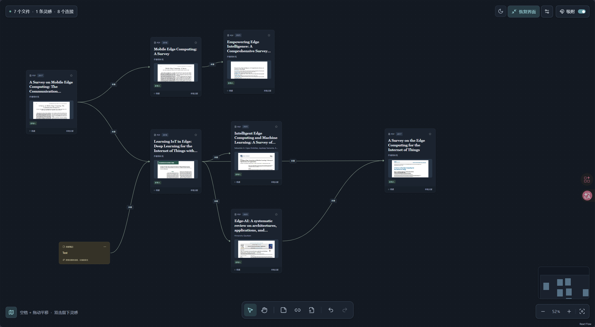
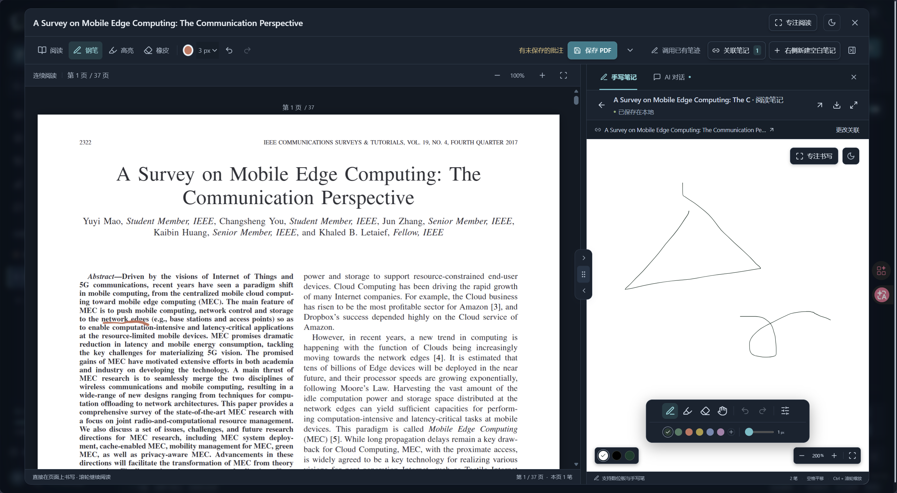
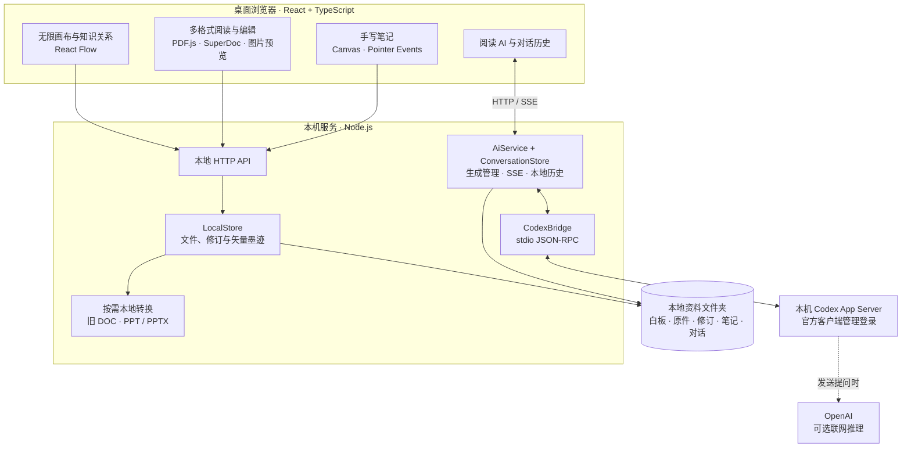

<p align="center">
  
</p>

<h1 align="center">PaperWithMap · Paperly 纸间</h1>

<p align="center"><strong>把文献、笔迹与思考，连接成一张研究地图。</strong></p>
<p align="center">无限画布 · 多格式阅读 · 关联手写 · 本地保存 · 可选 AI</p>

<p align="center">
  <a href="#功能预览">功能预览</a> ·
  <a href="#架构设计">架构设计</a> ·
  <a href="#快速开始">快速开始</a> ·
  <a href="docs/user-guide.md">使用指南</a>
</p>

Paperly 是面向桌面研究场景的本地文献工作台。把论文放上无限画布，用卡片与连线梳理研究脉络；打开文献后，在旁边书写、推导或提问，再把新的想法关联回原文。

**文献库无需登录，资料默认保存在本机。** 当前采用浏览器前端与 Node.js 本地服务运行，可选的阅读 AI 通过本机 Codex 桥接接入。



<p align="center"><sub>画布实机截图 · 自由布局、文献预览、关系连线与专注模式</sub></p>

## 从收集文献，到建立联系

| 研究中的一步 | 在 Paperly 中完成 |
| --- | --- |
| 收集资料 | 拖入 PDF、Word、PPT 或图片，生成可移动、可缩放的文件卡片 |
| 整理脉络 | 用自定义连线表达引用、对比与衍生思路，在画布、时间轴和图谱之间切换 |
| 阅读推导 | 连续滚动阅读 PDF，在原文批注，或在右侧新建自动关联的手写笔记 |
| 理解难点 | 对选中文字提问、总结全文或解释公式，接收流式回答并调整推理强度 |
| 沉淀思考 | 将回答保存为关联文字笔记，通过来源卡片重新找到笔迹与对话 |

## 功能预览

### 一张画布，组织不同形式的知识

论文卡片与文字节点共享拖拽、缩放和连接能力。卡片上的作者、关键词、预览图、年份与阅读状态都可按白板或单卡设置；时间轴让文献回到研究发展的顺序，知识图谱呈现手动建立的关系。

阅读工作区支持论文居左、白板与 AI 上下排列，也可三栏并排或独立分页；横向与纵向分隔线可调大小。白板支持矩形与箭头，浮动工具栏可收起、拖动并记住位置。沉浸阅读保留阅读、批注与缩放工具。AI 提问跟随选区或当前页，支持文字与截图、公式图表框选，并显示引用页码。

浅色、暗色、跟随系统三种外观覆盖主要页面。白板、阅读器和笔记页均可进入专注模式，把更多空间留给内容。

光标随选词、拖动、连线、缩放及书写工具变化；右键菜单覆盖画布、卡片、连线、文献库、阅读、图片、笔记与对话历史，常用操作就近完成。支持键盘导航与快捷键，Word 和文本输入保留编辑菜单。

### 左侧读原文，右侧留下推导



<p align="center"><sub>阅读实机截图 · 连续滚动 PDF、矢量批注与关联手写分屏</sub></p>

PDF 全文连续排列，按视野绘制附近页面，可直接滚动到文章末尾。钢笔、荧光笔、压感、橡皮与撤销重做支持边读边写；保存后，矢量墨迹嵌入平台管理的 PDF 副本，外部阅读器也能看到。

阅读工具栏可开启「划词翻译」，选中单词或短语即弹出有道词典音标与释义。默认关闭，关闭后不查询；无需 GPT 或 AI 额度，支持 PDF、PPT 文字预览与 Word 正文选区。开启时仅将选中的文字联网发送至有道词典。

右侧空白笔记创建后即关联当前文件，也可调用已有笔记。独立笔记库支持检索、重命名、回收站和 PNG 导出，并提供纯白、纯黑与黑板绿三种书写背景。

### 多种文件，共享同一套关联方式

| 文件类型 | 平台内体验 | 编辑与保存 |
| --- | --- | --- |
| **PDF** | 连续阅读、选中文字、缩放、手写批注 | 墨迹写入 PDF，保留导入原件与修订 |
| **Word · DOCX** | 兼容 Word 的编辑内核，直接修改正文 | 基础排版、列表、图片与表格；保存真实 DOCX |
| **Word · DOC** | 本地转换为 DOCX 工作稿后编辑 | 原始 DOC 保留，修改存为 DOCX |
| **PPT / PPTX** | 本地生成静态预览，连续浏览全部幻灯片 | 批注写入预览 PDF，原 PPT 由默认软件打开 |
| **JPG / JPEG / PNG** | 图片预览、放大、平移、命名与备注 | 原图保留，可关联手写笔记与其他卡片 |

Word、PDF 和 PPT 均可选择在平台内或默认软件中打开。旧 DOC 与 PPT 的平台内处理需要本机 Office 或配置 LibreOffice；DOCX 直接编辑、PDF 与图片不依赖该转换器。

### 阅读 AI，让提问也有出处

阅读页提供论文、手写笔记与 AI 对话三个独立分页，也可三栏并排；拖动边缘调整宽度，拖动标题把手重新排序，布局自动保留。选区提问、全文总结和公式解释共用当前文献上下文；提问与回答支持 Markdown、表格与 LaTeX，代码块可复制，回答可切换源码与预览。内容按增量实时显示，可停止生成。

模型和推理强度由本机 Codex 返回的能力决定，并记住各模型的选择。回答可保存为自动连回来源文献的文字卡片；首页对话历史支持检索、分页、继续提问和 Markdown 导出。

文献与对话保存在本机；**发送 AI 提问时，相关文献内容和对话上下文会联网传给 OpenAI**。AI 是可选模块，需本机 Codex 的 ChatGPT 登录与账号获准的 Codex 额度；文献库本身无需登录。

## 架构设计

Paperly 将研究交互、文件保存与可选 AI 分开：浏览器负责画布和编辑体验，本地服务负责文档、修订与关联，Codex 子进程承接 AI 请求。文献库的使用不依赖 AI 连接。



### 三个核心设计

**用稳定标识关联内容。** 文件 ID 与白板节点锚点把文献卡片、手写笔记和对话来源连接起来。阅读侧栏、笔记库与对话历史通过同一来源回到文献，减少在不同页面重新寻找上下文。

**把修改保存为真实文件。** PDF 批注由 `pdf-lib` 嵌入页面，Word 编辑输出 DOCX；本地服务保留原件与修订，结合版本号和文件校验检测冲突。JSON 保存白板、笔迹与对话结构，整个资料文件夹可备份迁移。

**让 AI 成为可选服务。** `AiProvider` 在页面切换时维护生成任务，后端将 Codex 消息增量通过 SSE 转发。每次生成使用临时 Codex 会话，以本地历史构造上下文；登录凭证由官方客户端管理，阅读助手禁用命令、插件和浏览器等工具。

### 技术组成

| 层次 | 主要技术 | 职责 |
| --- | --- | --- |
| 研究工作台 | React 19 · TypeScript · React Flow | 画布、卡片、关系、跨页状态 |
| 文档与手写 | PDF.js · pdf-lib · SuperDoc · perfect-freehand | 阅读、编辑、压感笔迹与 PDF 墨迹嵌入 |
| 本地数据服务 | Node.js HTTP · 文件系统 · sharp · yauzl · cfb | 文件识别、缩略图、修订和持久化 |
| 阅读 AI | Codex App Server · JSON-RPC · SSE · KaTeX | 动态模型、推理强度、流式回答与公式排版 |
| 验证 | Vitest · Node.js Test Runner | 布局逻辑、文件保存、转换与 AI 协议集成 |

实现入口：[画布与工作区](src/App.tsx) · [本地文件服务](server/storage.mjs) · [AI 服务](server/ai-service.mjs) · [Codex 桥接](server/codex-bridge.mjs)。

## 快速开始

准备 **Node.js 22.18 或更新版本**，在项目目录执行：

```sh
git clone https://github.com/xiluii/PaperWithMap.git
cd PaperWithMap
npm ci
npm run dev
```

打开 **[http://127.0.0.1:5173](http://127.0.0.1:5173)**，开发命令会同时启动前端与本地后端。首次运行自动创建 `data/` 资料库与示例白板。

构建后，可由同一个 Node.js 服务提供界面和文件 API：

```sh
npm run build
npm start
```

此时访问 **[http://127.0.0.1:4317](http://127.0.0.1:4317)**。

如需阅读 AI，另行安装 `npm install -g @openai/codex`，在阅读页连接本机 Codex。已有本机 ChatGPT 登录时可直接检测连接；更多登录、转换器与代理配置见 [使用指南](docs/user-guide.md)。

## 本地数据，由你保管

```text
data/
├─ workspace.json       # 白板、卡片与关系
├─ papers/              # 文档原件、元数据与修订
├─ notes/               # 手写笔记
├─ conversations/       # 本平台对话、上下文与回答状态
└─ ai-codex/            # 本平台连接偏好；不存储 Codex 登录令牌
```

默认只接受本机访问。资料库目录可通过 `PAPERLY_DATA_DIR` 调整；完整迁移请备份整个资料文件夹，白板 JSON 导出不包含文档二进制文件。界面偏好保存在浏览器，首次连接本地资料库时可迁移早期 IndexedDB 数据。

## 文档与验证

- [使用与开发指南](docs/user-guide.md)：操作、配置、备份、快捷键和开发命令。
- [多文件验收](docs/multi-file-acceptance.md)：Word 保存、PPT 转换、图片与关联笔记。
- [Codex 桥接验收](docs/codex-bridge-acceptance.md)：真实调用、流式输出、推理强度与本地历史。
- [对话界面验收](docs/chat-ui-acceptance.md)：Markdown 排版、中文强调、代码复制和窄窗口布局。
- [暗色模式验收](docs/dark-mode-acceptance.md) · [工作台设计规范](docs/design-system.md)。
- [源码发布与隐私](docs/publication.md) · [第三方组件声明](THIRD_PARTY_NOTICES.md)。

当前验收记录：**103 项测试通过**，包含文件持久化、PDF 墨迹、DOCX 修订、真实 Office 转换和 AI 流式协议；TypeScript 与 Vite 构建通过。复验命令为 `npm test` 与 `npm run build`；独立阅读分页与可移动侧栏见[布局验收](docs/panel-layout-acceptance.md)，光标与右键菜单见[交互验收](docs/interaction-acceptance.md)，划词翻译见[词典验收](docs/reading-translation-acceptance.md)。缺少本地转换器时，Office 用例会明确跳过。

## 当前阶段

项目目前是**面向桌面浏览器的本地原型**，尚未提供 Electron 安装包。知识关系由用户建立；PDF 元数据提取采用启发式处理。Word 复杂版式可能与微软 Word 有差异；PPT 的动画、视频和编辑使用默认软件。真实数位板端到端延迟与 60 / 120 fps 性能尚未完成基准测量。

仓库尚未指定项目开源许可证。使用和分发时请同时查看 [第三方组件声明](THIRD_PARTY_NOTICES.md)，Word 编辑内核包含单独的授权条款。Codex 接入面向本机使用，账号可用模型、额度和使用范围以适用规则为准。
